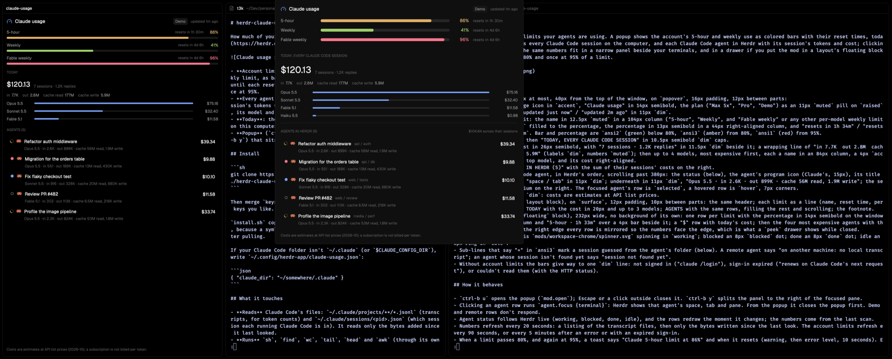

# herdr-claude-usage

How much of your Claude limits your agents are using, inside the [Herdr](https://herdr.dev) desktop app.



- **Account limits**: your 5-hour and weekly use, plus any per-model weekly limit, as bars that turn amber at 80% and red at 95%, with the time until each resets. A toast tells you once when a limit passes 80% and once at 95%.
- **Every agent's session**: for each Claude Code agent in Herdr, its session's tokens (input, output, cache read and write, subagents included), its model and an estimated cost. Click a row to go to that agent.
- **Today**: the estimated cost and tokens of every Claude Code session on this computer since midnight, by model.
- **Popup** (`ctrl-b u`) with the full breakdown, and a **panel** (`ctrl-b y`) that sits beside your terminals.

## Install

```sh
git clone https://github.com/cunderw/herdr-claude-usage
./herdr-claude-usage/install.sh
```

Then merge `keys.json` into `~/.config/herdr-app/keys.json`, or bind the keys you like.

`install.sh` copies the mod into `~/.config/herdr-app/mods/claude-usage`, because a symlinked mod folder doesn't draw its icons. Run it again after pulling.

If your Claude Code folder isn't `~/.claude` (or `$CLAUDE_CONFIG_DIR`), write `~/.config/herdr-app/claude-usage.json`:

```json
{ "claude_dir": "~/somewhere/.claude" }
```

## What it touches

- **Reads** Claude Code's files: `~/.claude/projects/**/*.jsonl` (transcripts, for token counts) and `~/.claude/sessions/<pid>.json` (which session each running Claude Code is in). It reads only the bytes added since it last looked.
- **Runs** `sh`, `find`, `wc`, `tail`, `head` and `awk` (through its own `scan.sh` and `scan.awk`), and `ls` when an agent's session can't be found from its process.
- **Reads your Claude Code sign-in** to ask for your limits: on macOS with `security find-generic-password -s "Claude Code-credentials"` (the Keychain may ask you to allow this once), elsewhere from `~/.claude/.credentials.json`. The token is sent only to `api.anthropic.com` and is never stored, shown or logged. It never refreshes the token; Claude Code does that.
- **Fetches** `https://api.anthropic.com/api/oauth/usage` at most once every 90 seconds (every 5 minutes after an error). It is not a documented public API, so it may change or stop answering. Without a sign-in, the limits are left out and everything else still works.

Costs are **estimates** at Anthropic's API list prices (`mods/claude-usage/pricing.js`). On a Pro or Max plan you aren't billed per token; the figure shows what the same tokens would cost on the API.

[RECIPE.md](RECIPE.md) has the full brief. Icons are from [Lucide](https://lucide.dev) (ISC).
