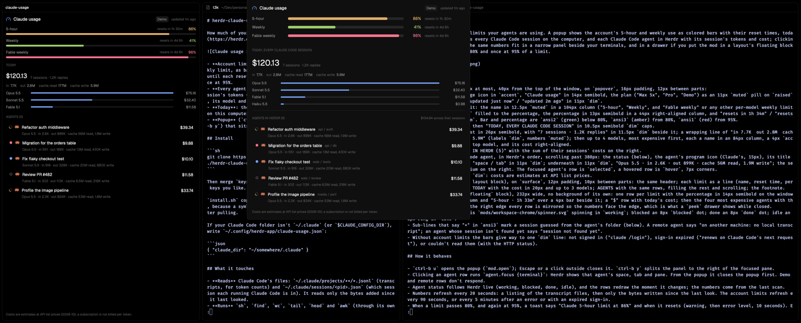

# Claude usage

How much of your Claude limits your agents are using. A popup shows the account's 5-hour and weekly use as colored bars with their reset times, today's estimated cost across every Claude Code session on the computer, and each Claude Code agent in Herdr with its session's tokens and cost; clicking an agent goes to it. The same numbers fit in a narrow panel beside your terminals, and in a drawer if you put the mod in a layout's floating block. A toast warns once at 80% and once at 95% of a limit.

## What you see

- **Popup**, 720 by 760px at most, 40px from the top of the window, on `popover`, 16px padding, 12px between parts:
  - A header: a 16px gauge icon in `accent`, "Claude usage" in 14px semibold, the plan ("Max 5x", "Pro", "Demo") as an 11px `muted` pill on `raised` with 5px corners, and "updated just now" / "updated 2m ago" in 11px `dim`.
  - One 22px row per limit: the name in 12.5px `muted` in a 104px column ("5-hour", "Weekly", and "Fable weekly" or any other per-model weekly limit), an 8px bar on `border` filled to the percentage, the percentage in 13px semibold in a 44px right-aligned column, and "resets in 1h 34m" / "resets in 4d 6h" in 11.5px `dim`. Bar and percentage are `ansi2` (green) below 80%, `ansi3` (amber) from 80%, `ansi1` (red) from 95%.
  - A 1px `border` rule, then "TODAY, EVERY CLAUDE CODE SESSION" in 10.5px semibold `dim` caps.
  - Today's estimated cost in 26px semibold, with "7 sessions · 1.2K replies" in 11.5px `dim` beside it; a wrapping line of "in 7.7K  out 2.8M  cache read 177M  cache write 5.9M" (labels `dim`, numbers `muted`); then up to 4 models, most expensive first, each a name in an 84px column, a 4px `accent` bar relative to the top model, and its cost right-aligned.
  - A rule, then "AGENTS IN HERDR (5)" with the sum of their sessions' costs on the right.
  - One row per Claude Code agent, in Herdr's order, scrolling past 380px: the status (below), the agent's program icon (Claude's, 15px), its title in 13px `foreground` and "space / tab" in 11px `dim`; underneath in 11px `dim`, "Opus 5.5 · in 2.6K · out 899K · cache 56M read, 1.9M write"; the session's cost in 13px medium on the right. The focused agent's row is `selected`, a hovered row is `hover`, 7px corners.
  - A footnote in 10.5px `dim`: costs are estimates at API list prices.
- **Panel** (a pane or a layout block), on `surface`, 12px padding, 10px between parts: the same header; each limit as a line (name, reset time, percentage) over a 6px bar; TODAY with the cost in 20px and up to 3 models; AGENTS with the same rows, filling the rest and scrolling; the footnote.
- **Drawer** (a layout `floating` block), 232px wide, no background of its own: one row per limit with the percentage in 14px semibold on the window-edge side of a 36px column and "5-hour · 1h 33m" over a 4px bar beside it; a "$" row with today's cost; then the four most expensive agents with their status and cost. On the right edge every row is mirrored so the numbers face the edge, which is what a `peek` drawer shows while closed.
- Agent status: working is `mods/workspace-chrome/spinner.svg` spinning in `working`; blocked an 8px `blocked` dot; done an 8px `done` dot; idle an 8px ring in `idle`.
- Sub-lines that say "≈" in `ansi3` mark a session guessed from the agent's folder (below). A remote agent says "on another machine: no local transcript"; an agent whose session isn't found yet says "session not found yet".
- Without account limits the bars give way to one `dim` line: not signed in ("claude /login"), sign-in expired ("renews on Claude Code's next request"), or couldn't read them (with the HTTP status).

## How it behaves

- `ctrl-b u` opens the popup (`mod.open`); Escape or a click outside closes it. `ctrl-b y` splits the panel to the right of the focused pane.
- Clicking an agent row runs `agent.focus {terminal}`: Herdr shows that agent's space, tab and pane. From the popup it closes the popup first. Demo and remote rows don't respond.
- Agent status follows Herdr live (working, blocked, done, idle), and the rows redraw the moment it changes; the numbers come from the last scan.
- Numbers refresh every 20 seconds: a listing of the transcript files, then only the bytes written since the last look. The account limits refresh every 90 seconds, or every 5 minutes after an error or with an expired sign-in.
- When a limit passes 80%, and again at 95%, a toast says "Claude 5-hour limit at 86%" and when it resets (warning, then error level, 10 seconds). Each fires once per reset period, whichever copy is open, and not again after a restart.
- Bar widths slide to a new value over 450ms (`transition("width")`). Nothing else animates and there is no redraw timer.

## Built from

- One mod, `mods/claude-usage/`. `mod.json`: `place: "none"` (nothing docks into your layout) and the popup overlay (`kind: popup`, `at: top`, `offset: 40`, 720 by 760).
- `main.js` picks the view: a non-null `placement()` is the drawer; `props { view: "panel" }` the panel; otherwise (opened by `mod.open`) the popup, closing itself with `props().overlay`.
- `data.js` collects, `view.js` draws, `pricing.js` holds the price table, `scan.sh` and `scan.awk` read transcripts.
- **One collector.** Copies of a mod share no module state, so every copy runs a `Collector`, but only the one holding the lease in shared `"claude-usage"` (`owner`, `beat`) works; the others draw from that shared value. A copy takes over a lease whose holder hasn't written for 100 seconds, and a closing copy (`close()`) hands it back at once, so a popup opened alone collects straight away. The collector writes only when something changed, or every 45 seconds to keep the lease, because each `setShared` redraws every mod in the window.
- **Agent to session.** For each agent in `agents()` with `app === "claude-code"` (or `program.key === "claude"`) and a local address, its terminal in `terminals()` gives `foreground.pid`, the running Claude Code. Claude Code writes `~/.claude/sessions/<pid>.json` with its `sessionId`, read with `readTextFile`. While Claude Code runs a tool the foreground can be the tool, so the last answer is kept. With no sessions file, the newest `*.jsonl` in the agent's project folder is used (`ls -t`; the folder is the cwd with every non-alphanumeric character as `-`) and marked "≈".
- **Transcripts.** `scan.sh list <projects> <minutes> <session ids…>` runs `find … -name '*.jsonl' ( -mmin -<since midnight> -o -path */<id>.jsonl -o -path */<id>/subagents/* ) -exec wc -c {} +`. `scan.sh read scan.awk <path> <offset> <size> …` pipes `tail -c +offset+1 | head -c size-offset` into `LC_ALL=C awk`, which prints `id model timestamp input output cache_read cache_write_5m cache_write_1h speed` per assistant line that has a usage object, and `#used <bytes>` counting only whole lines, so a line still being written is read next time. The collector keeps per file: the offset, the last message id, the last model, and totals per local day and model. Up to 150 MB or 80 files go in one `exec`.
- A session's usage is its `<id>.jsonl` plus every `<id>/subagents/*.jsonl`. Today is every file written since local midnight, counting lines whose timestamp falls today.
- **Limits.** The sign-in is Claude Code's: on macOS `security find-generic-password -s "Claude Code-credentials" -w`, else `<claude dir>/.credentials.json`, both JSON with `claudeAiOauth.{accessToken, expiresAt, subscriptionType, rateLimitTier}`. `fetch("https://api.anthropic.com/api/oauth/usage", {headers: {Authorization: "Bearer …", "anthropic-beta": "oauth-2025-04-20"}})` returns `five_hour` and `seven_day` (`utilization`, `resets_at`), optional `seven_day_opus` / `seven_day_sonnet`, and `limits[]`, whose `weekly_scoped` entries name a model (`scope.model.display_name`, e.g. "Fable"). The plan label comes from `rateLimitTier` (`…max_5x` → "Max 5x") or `subscriptionType`.
- **Costs** (`pricing.js`, dated `AS_OF`): dollars per million tokens per model prefix, longest match wins: input, output and cache read; cache writes are 1.25x input (5-minute) and 2x input (1-hour); `speed: "fast"` doubles it; Haiku 5.5 prompts over 100K use its second rate card. Each reply is priced on its own, so a session that switches models is priced right. An unknown model counts tokens and shows its cost with a "+".
- Config, optional, `claude-usage.json` in the Herdr home: `{ "claude_dir": "~/.claude" }` (default `$CLAUDE_CONFIG_DIR`, else `~/.claude`), or `{ "demo": "<folder>" }` to show made-up data from `demo/make-demo.py` (agents.json, quota.json and transcripts dated today) for screenshots.
- Herdr functions: `props`, `placement`, `agents`, `terminals`, `theme`, `shared`, `setShared`, `notify`, `run`, `closeOverlay`, `exec`, `readTextFile`, `home`, `appHome`, `window`, and `fetch`. Commands: `mod.open`, `pane.split` (with `mod`/`props`), `agent.focus`.
- Icons: Lucide's `gauge` and `sparkle` (ISC), tinted with `svg()`; the agent's own program icon from Herdr; the shipped `workspace-chrome` spinner.

## Watch out

- **Install by copying.** A symlinked mod folder loads its JavaScript but draws no icons. `install.sh` copies the files. The scripts are found at `<Herdr home>/mods/claude-usage/`, the `MOD` constant in `data.js`: rename both together.
- Transcripts are large (tens of MB for a long session with subagents). Never read them whole on every refresh, and not with `readTextFile` (1 MiB limit). Reading from a byte offset with `tail -c` keeps a refresh to milliseconds; the first scan of a busy day reads everything once (about 3 seconds for 74 files on the machine it was built on).
- One reply is written as several lines with the same `message.id` and identical usage. Count each id once. They are always consecutive, so remembering the last id per file is enough.
- The usage on a line is the last `"usage":{` on it: it comes after the message content, and quotes inside content strings are escaped. Check `"type":"assistant"`; other line types carry no usage.
- A session's subagents write to `<id>/subagents/`, not to `<id>.jsonl`. Most of a team session's tokens are there.
- The usage endpoint is not a documented API. Its shape has changed before and may again; anything missing is left out rather than shown as 0. Never refresh the OAuth token yourself: that rotates Claude Code's refresh token. An expired token waits for Claude Code to renew it.
- On macOS the first `security` call from Herdr may ask to allow Keychain access.
- `resets_at` has six fractional digits; trim to three before `new Date()`. There is no `Intl`: numbers are formatted by hand.
- Herdr's agent list and `agent.next` order belong to the agents mod; this mod doesn't call `setAgentOrder`.
- Remote agents (an address with `/`) have no local transcript and show without numbers. The quota is the signed-in account's on this computer.
- A floating block needs your layout to place it: add `{ "id": "claude-usage", "content": { "mod": "claude-usage" }, "edge": "right", "align": "center", "peek": 52 }` to a node's `floating`. The drawer view was checked by rendering it in a pane with a forced placement, not as a real floating block.
- A view that throws while drawing shows Herdr's "This view could not be rendered" box, but `herdr-app status` still lists no errors. Look at a `herdr-app shot` after every change.
- Costs are estimates. Subscription plans aren't billed per token, and the table needs editing when prices change.

## Done when

- `herdr-app check ~/.config/herdr-app/mods/claude-usage` passes and `herdr-app status` shows no errors.
- `herdr-app do mod.open --name claude-usage` shows the account's limits as Claude Code reports them, today's cost, and one row per Claude Code agent in Herdr with a session cost.
- A row's tokens match a JSON parse of `<id>.jsonl` plus `<id>/subagents/*.jsonl`, deduplicated by `message.id`.
- Clicking a row shows that agent and closes the popup.
- With `{ "demo": … }` from `demo/make-demo.py`, the 5-hour bar is amber at 86%, Fable weekly red at 96%, and two toasts appear once.
- `pane.split {direction: "right", mod: "claude-usage", props: {view: "panel"}}` shows the panel; with no Claude sign-in it shows a note in place of the bars and still lists agents.
